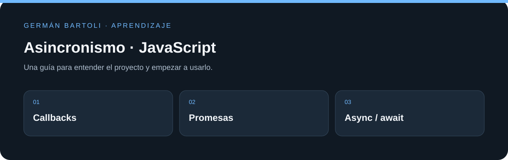

# Asincronismo · JavaScript

**Ejercicios de callbacks, promesas, async/await y generadores, acompañados por una landing que consume datos externos.**

[Empezar](#primeros-pasos) · [Mapa del repositorio](#mapa-del-repositorio) · [Autoría](#autoría-de-esta-documentación)

*Esquema de orientación; no representa una captura de la aplicación.*

## Primeros pasos

1. Abrí `Proyecto Asincronismo/` y revisá sus scripts en `package.json`.
2. Recorré los ejemplos por carpeta: `CallBack`, `Promise`, `Async` y `Generator`.
3. Abrí la landing indicada en los enlaces originales para ver el ejemplo de navegador; las consultas dependen de las APIs externas utilizadas.

## Entorno de aprendizaje

Este repositorio conserva ejercicios y versiones de su etapa de estudio. Revisá los archivos de proyecto para preparar el SDK, runtime o servidor correspondiente; esta actualización del README no migra dependencias ni acredita una ejecución reciente de todos los ejemplos.

## Enlaces

- [Sitio publicado en GitHub Pages](https://germanbartoli.github.io/Asynchronism-Js/Proyecto%20Asincronismo/src/Async%20Landing/)
- [Repositorio en GitHub](https://github.com/GermanBartoli/Asynchronism-Js)

https://germanbartoli.github.io/Asynchronism-Js/Proyecto%20Asincronismo/src/Async%20Landing/

https://github.com/platzi/curso-asincronismo-js

https://bit.ly/3JT9Mhr

https://marketplace.visualstudio.com/items?itemName=formulahendry.code-runner

https://fakeapi.platzi.com/

## Mapa del repositorio

- [Proyecto Asincronismo/package.json](<Proyecto Asincronismo/package.json>)
- [Proyecto Asincronismo/src/Async Landing/index.html](<Proyecto Asincronismo/src/Async Landing/index.html>)
- [Proyecto Asincronismo/src/CallBack/index.html](<Proyecto Asincronismo/src/CallBack/index.html>)
- [docs/PUBLICACION.md](<docs/PUBLICACION.md>)

## Autoría de esta documentación

Repositorio mantenido por [Germán Bartoli](https://github.com/GermanBartoli). Guía revisada y actualizada con **Codex**, coautor de esta actualización documental. Los autores, colaboradores, licencias y recursos de terceros conservan sus créditos originales.

Los commits de esta revisión incluyen `Co-authored-by: Codex <noreply@openai.com>`; esta atribución no modifica la autoría del historial anterior.
